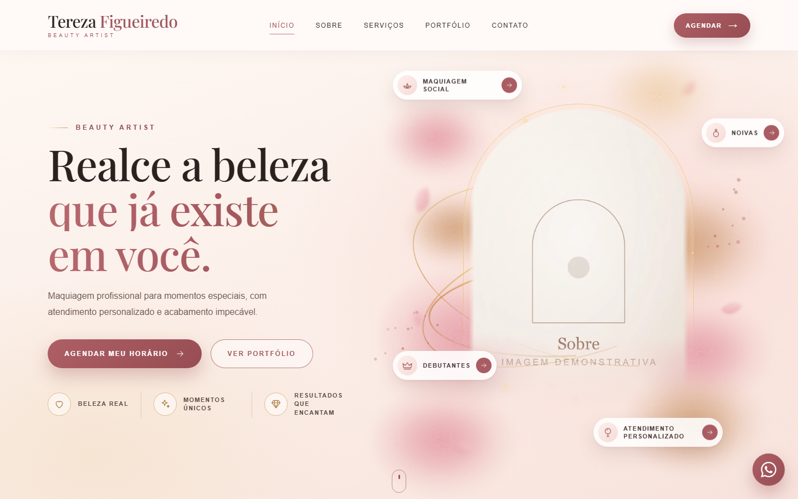
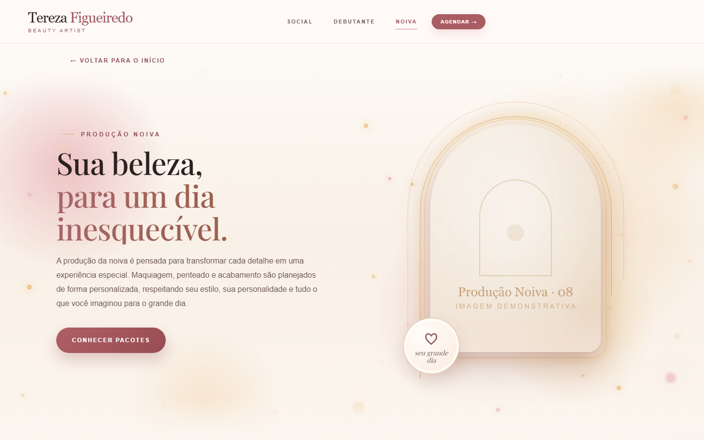
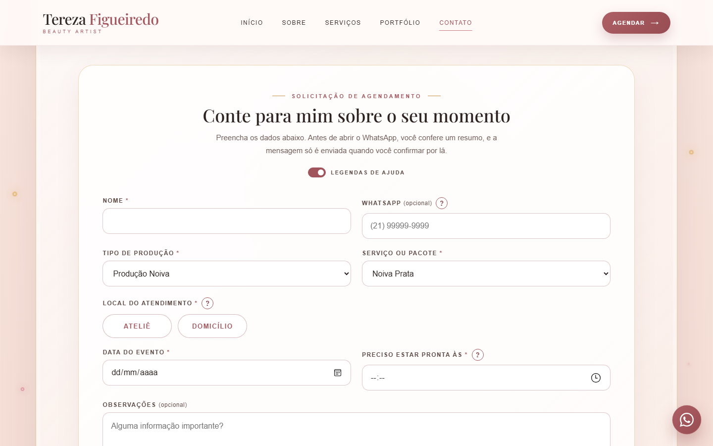
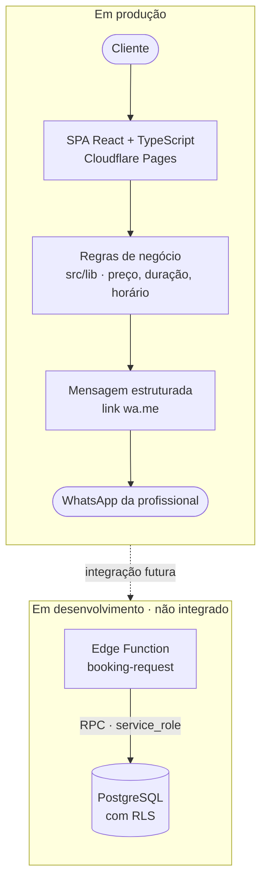

<div align="center">

# BeautyOS

**Plataforma web de apresentação de serviços e pré-agendamento para profissionais da beleza — construída para resolver um gargalo real de atendimento.**

[](https://react.dev/)
[](https://www.typescriptlang.org/)
[](https://vite.dev/)
[](https://reactrouter.com/)
[](https://supabase.com/)
[](https://pages.cloudflare.com/)

[**Acessar a aplicação**](https://terezafigueiredobeauty.com.br/) · [Produção Social](https://terezafigueiredobeauty.com.br/social) · [Produção Debutante](https://terezafigueiredobeauty.com.br/debutante) · [Produção Noiva](https://terezafigueiredobeauty.com.br/noiva) · [Aviso de privacidade](https://terezafigueiredobeauty.com.br/privacidade)

<br>



</div>

> [!NOTE]
> **Sobre este repositório.** O BeautyOS é um projeto autoral, desenvolvido para o meu próprio negócio e **em produção** em [terezafigueiredobeauty.com.br](https://terezafigueiredobeauty.com.br/). Este repositório é a **versão pública de portfólio**: o código da aplicação (componentes, tipagens, regras de negócio, estilos, backend e configurações de segurança) é o mesmo da produção (salvo um ajuste pontual de privacidade em um texto alternativo), mas as **fotografias de clientes foram substituídas por imagens demonstrativas** com os mesmos nomes e dimensões, para preservar o direito de imagem de cada pessoa. O desenvolvimento acontece em um repositório privado; este tem histórico Git próprio.

---

## Sumário

- [O problema](#o-problema)
- [A solução](#a-solução)
- [Funcionalidades implementadas](#funcionalidades-implementadas)
- [Regras de negócio](#regras-de-negócio)
- [Capturas de tela](#capturas-de-tela)
- [Stack tecnológica](#stack-tecnológica)
- [Arquitetura](#arquitetura)
- [Decisões técnicas](#decisões-técnicas)
- [Responsividade e experiência do usuário](#responsividade-e-experiência-do-usuário)
- [Acessibilidade digital](#acessibilidade-digital)
- [Segurança e privacidade](#segurança-e-privacidade)
- [Qualidade e testes](#qualidade-e-testes)
- [Como executar localmente](#como-executar-localmente)
- [Roadmap](#roadmap)
- [Autoria](#autoria)

---

## O problema

Sou maquiadora profissional e estudante de Análise e Desenvolvimento de Sistemas. No dia a dia do ateliê, uma parte significativa do tempo era consumida **interrompendo atendimentos** para responder sempre às mesmas perguntas pelo WhatsApp:

- Quais serviços e pacotes estão disponíveis e o que cada um inclui?
- Quanto custa no ateliê e quanto custa a domicílio?
- Quanto tempo leva a produção e a que horas preciso começar para estar pronta a tempo?
- Quais informações devo enviar para pedir um horário?

Cada interrupção atrasava a cliente que estava na cadeira e, ainda assim, as solicitações chegavam incompletas, exigindo várias trocas de mensagens até que o pedido pudesse ser avaliado.

## A solução

O BeautyOS centraliza essas informações em uma aplicação web e transforma o pedido de agendamento em um **fluxo guiado e autoexplicativo**. A cliente consulta serviços, valores e duração, preenche um formulário validado e recebe uma mensagem estruturada pronta para enviar pelo WhatsApp — com todos os dados necessários para que a disponibilidade seja confirmada em uma única resposta.

| Para a cliente | Para a profissional |
| --- | --- |
| Consulta serviços, pacotes, itens incluídos e valores a qualquer hora | Menos interrupções durante os atendimentos |
| Vê o preço correto para ateliê ou domicílio antes de pedir | Solicitações chegam completas e padronizadas |
| Recebe o horário estimado de início da produção | Regras de preço centralizadas em um único módulo |
| Revisa a mensagem antes de enviá-la | Nenhum dado pessoal armazenado pelo site |

> **Estágio atual:** o site público está em produção e o envio do pedido é feito pelo WhatsApp, com confirmação manual da disponibilidade. Em paralelo, a fundação de um backend de agendamento com Supabase está em desenvolvimento e **ainda não está integrada ao frontend** (veja [Roadmap](#roadmap)).

---

## Funcionalidades implementadas

### Catálogo de serviços

- **Página inicial** com apresentação profissional, seção "Sobre", visão geral dos serviços, portfólio e formulário de agendamento. A seção de depoimentos já está estruturada, mas só é exibida quando houver depoimentos com autorização expressa das clientes — hoje ela não aparece.
- **Páginas dedicadas** por tipo de produção: [Social](https://terezafigueiredobeauty.com.br/social), [Debutante](https://terezafigueiredobeauty.com.br/debutante) e [Noiva](https://terezafigueiredobeauty.com.br/noiva), cada uma com galeria editorial e catálogo próprio.
- **Produção Social:** seis serviços (maquiagem, babyliss, penteado e combinações, além de produção infantil), cada um com itens incluídos, duração e preço.
- **Pacotes Noiva e Debutante:** níveis Bronze, Prata e Ouro, com valores distintos para ateliê e domicílio; o pacote Ouro tem preço fixo e é realizado no local do evento.
- **Página de aviso de privacidade** ([/privacidade](https://terezafigueiredobeauty.com.br/privacidade)) e página 404 personalizada.

### Pré-agendamento guiado

- Formulário da página inicial com seleção encadeada **tipo de produção → serviço/pacote → local do atendimento**, mostrando apenas os locais permitidos para cada opção.
- **Pré-seleção por URL**: os botões das páginas de serviço levam ao formulário com a produção ou o pacote já escolhidos (ex.: `/?servico=noiva-prata#agendamento-formulario`).
- **Cálculo do horário estimado de início** a partir do horário em que a cliente precisa estar pronta e da duração do serviço.
- **Validação** de campos obrigatórios, telefone brasileiro (10 ou 11 dígitos, com ou sem código do país), endereço obrigatório para atendimento a domicílio e data mínima igual ao dia atual.
- **Etapa de confirmação** em janela modal antes de abrir o WhatsApp, com trava contra clique duplo.
- **Mensagem estruturada** para o WhatsApp contendo produção, serviço, local, valor, data, horários, duração e contato.
- **Fallback de cópia**: se o WhatsApp não abrir, a interface oferece copiar a mensagem (Clipboard API, com alternativa para navegadores sem suporte).

### Navegação e conteúdo

- Roteamento client-side com React Router e fallback de SPA configurado no host.
- Cabeçalho com destaque da seção ativa durante a rolagem e menu mobile.
- Galerias com navegação por botões e opção de pausar o movimento automático.
- Botão flutuante de contato pelo WhatsApp.

---

## Regras de negócio

As regras ficam centralizadas em [`src/lib/pricing.ts`](src/lib/pricing.ts) e [`src/lib/bookingFormUtils.ts`](src/lib/bookingFormUtils.ts) e nos dados de cada página de serviço. Os valores abaixo são os definidos no código.

**Produção Social** — preço base no ateliê; a domicílio soma um adicional fixo de **R$ 150,00**, aplicado uma única vez em `socialPriceCents()`.

| Serviço | Ateliê | Domicílio | Duração |
| --- | ---: | ---: | ---: |
| Maquiagem Social | R$ 200,00 | R$ 350,00 | 1h |
| Maquiagem + Babyliss | R$ 300,00 | R$ 450,00 | 2h |
| Maquiagem + Penteado | R$ 350,00 | R$ 500,00 | 3h |
| Babyliss | R$ 100,00 | R$ 250,00 | 1h |
| Penteado | R$ 150,00 | R$ 300,00 | 1h30 |
| Produção Infantil | R$ 150,00 | R$ 300,00 | 1h30 |

**Pacotes Noiva e Debutante** — mesma tabela de preços para as duas páginas. Os valores a domicílio são preços finais (sem adicional), e o pacote Ouro tem preço fixo e é realizado apenas no local do evento.

| Pacote | Ateliê | Domicílio | Duração (Noiva / Debutante) |
| --- | ---: | ---: | ---: |
| Bronze | R$ 400,00 | R$ 700,00 | 3h / 3h |
| Prata | R$ 650,00 | R$ 900,00 | 3h / 3h |
| Ouro | — | R$ 1.800,00 | 8h / 10h |

**Agendamento**

- Horário estimado de início = horário em que a cliente precisa estar pronta − duração do serviço. Se o resultado cair no dia anterior, nenhum horário é sugerido.
- Endereço obrigatório apenas para atendimento a domicílio.
- Data do evento a partir do dia atual, calculada no fuso local.
- A opção "Outro serviço (a combinar)" não exibe valor; o preço só aparece quando há correspondência exata com a tabela.
- A disponibilidade é confirmada manualmente pela profissional; nada é reservado automaticamente nesta fase.

---

## Capturas de tela

Capturas da versão de portfólio executada localmente (`npm run build` + `npm run preview`), já com as imagens demonstrativas. A versão em produção, com as fotos reais, pode ser vista em [terezafigueiredobeauty.com.br](https://terezafigueiredobeauty.com.br/).

<table>
  <tr>
    <th>Desktop — página de serviço (Noiva)</th>
    <th>Desktop — formulário de agendamento</th>
  </tr>
  <tr>
    <td></td>
    <td></td>
  </tr>
</table>

<table>
  <tr>
    <th>Mobile — página inicial</th>
    <th>Mobile — Produção Social</th>
  </tr>
  <tr>
    <td align="center"></td>
    <td align="center"></td>
  </tr>
</table>

---

## Stack tecnológica

| Camada | Tecnologias |
| --- | --- |
| **Frontend** | React 19, TypeScript 6 (modo estrito de módulos, `noUnusedLocals`, `noUnusedParameters`), React Router 7 |
| **Estilização** | CSS3 puro organizado por domínio, sem framework de UI; fonte Playfair Display auto-hospedada (WOFF2, licença OFL) |
| **Build e tooling** | Vite 8, `@vitejs/plugin-react`, verificação de tipos com `tsc` no build |
| **Backend (em desenvolvimento)** | Supabase: PostgreSQL com Row Level Security, migrations SQL versionadas e Edge Function em Deno/TypeScript |
| **Integrações** | WhatsApp (links `wa.me` com mensagem pré-preenchida) |
| **Infraestrutura** | Cloudflare Pages (cabeçalhos de segurança via `_headers`, fallback de SPA via `_redirects`); `vercel.json` com rewrite equivalente |
| **Ferramentas auxiliares** | Script Python com Pillow para gerar imagens WebP otimizadas a partir das fotos originais (usado na produção; as fotos originais não fazem parte deste repositório) |

---

## Arquitetura

### Visão geral



O site público é uma **SPA estática sem estado no servidor**: todo o cálculo de preço, duração e horário acontece no navegador, a partir de uma fonte única de regras. Nenhum dado da cliente é gravado — a mensagem só sai do dispositivo quando ela própria a envia pelo WhatsApp.

### Estrutura de diretórios

```text
BeautyOS-Portfolio/
├── public/
│   ├── _headers                # CSP e demais cabeçalhos de segurança (Cloudflare Pages)
│   └── _redirects              # fallback de SPA
├── scripts/
│   └── optimize-images.py      # gera WebP otimizados e remove metadados EXIF/GPS
├── src/
│   ├── main.tsx                # bootstrap: Router, provider de legendas de ajuda, estilos
│   ├── App.tsx                 # definição de rotas
│   ├── pages/                  # Social, Debutante, Noiva, Privacy, NotFound
│   ├── components/
│   │   ├── a11y/               # componentes de acessibilidade reutilizáveis
│   │   ├── editorial/          # hero, seções e galerias das páginas de serviço
│   │   ├── home/               # hero, formulário de agendamento, opções de serviço
│   │   └── *.tsx               # Header, Footer, Services, Portfolio, BookingModal...
│   ├── lib/                    # lógica de negócio pura (sem React, sem rede)
│   │   ├── pricing.ts          # regras de preço em centavos
│   │   ├── bookingFormUtils.ts # datas, horários, validação de telefone, cópia
│   │   └── bookingWhatsappMessage.ts
│   ├── config/                 # contato, textos de ajuda e dados de privacidade
│   ├── hooks/                  # useActiveSection, useInView, useHeroMotion
│   ├── styles/                 # CSS por domínio (home, editorial, a11y, privacy...)
│   └── assets/                 # imagens WebP (demonstrativas nesta versão) e fonte auto-hospedada
└── supabase/
    ├── config.toml
    ├── functions/booking-request/   # Edge Function (Deno)
    └── migrations/                  # 000 a 006, schema e hardening incrementais
```

### Separação de responsabilidades

- **`src/lib`** concentra regras de negócio em **funções puras**, sem dependência de React ou de rede — o que as torna reutilizáveis entre o formulário da página inicial e o modal das páginas de serviço.
- **`src/config`** isola dados específicos da profissional (contato, nome, textos de privacidade). Os componentes de acessibilidade e a página de privacidade foram escritos de forma genérica, permitindo reutilização para outra profissional apenas trocando a configuração.
- **`src/components/home/bookingOptions.ts`** monta as opções do formulário a partir **dos mesmos dados** exportados pelas páginas de serviço, evitando duplicação de nomes, durações e preços.

---

## Decisões técnicas

| Decisão | Motivação |
| --- | --- |
| **Valores monetários em centavos inteiros** (`pricing.ts`) | Evita erros de arredondamento de ponto flutuante; a conversão para texto ocorre apenas na exibição, via `Intl.NumberFormat` em `pt-BR`. |
| **Fonte única de regras de preço** | O adicional de domicílio da Produção Social (+R$ 150,00) é aplicado em um único lugar; Noiva e Debutante compartilham a mesma tabela de pacotes. |
| **Fluxo via WhatsApp antes de um backend** | Resolve o problema real imediatamente, sem coletar nem armazenar dados pessoais, enquanto a arquitetura de agendamento é construída com segurança. |
| **Datas locais sem `toISOString()`** | Impede que a data mínima do formulário "volte" um dia perto da meia-noite por conversão para UTC. |
| **Horário de início não sugerido quando inviável** | Se a duração não cabe antes do horário informado, o cálculo retorna vazio em vez de um horário do dia anterior. |
| **Confirmação antes de abrir o WhatsApp** | A cliente revisa o resumo; a abertura do app é detectada pela perda de foco da página e, se nada acontecer, é oferecida a cópia da mensagem. |
| **CSS próprio e fonte auto-hospedada** | Identidade visual sob controle total e CSP restrita a `'self'`, sem dependência de CDNs de fontes ou estilos. |
| **Imagens WebP pré-processadas** | Script dedicado redimensiona (lado maior de 1600 px), aplica orientação EXIF e remove metadados — incluindo localização GPS das fotos de celular. |

---

## Responsividade e experiência do usuário

- Layout responsivo com menu recolhível no mobile, botões de ação em largura total e grids que se reorganizam em telas menores (ver [capturas](#capturas-de-tela)).
- Fluxo pensado para quem chega pelo celular: atalhos das páginas de serviço levam direto ao formulário com a opção correta já selecionada.
- **Legendas de ajuda** (botões "?") nos campos que costumavam gerar dúvidas, com preferência para ativar ou desativar.
- Mensagens de erro próximas a cada campo e foco movido automaticamente para o primeiro campo inválido.
- Imagens abaixo da dobra com `loading="lazy"`, `fetchPriority` nas imagens prioritárias, `font-display: swap` e animações disparadas apenas quando a seção entra na tela (`IntersectionObserver`).

---

## Acessibilidade digital

A acessibilidade foi tratada como requisito, com componentes dedicados em [`src/components/a11y`](src/components/a11y). As práticas abaixo estão **implementadas no código**; elas se alinham a critérios das WCAG 2.2 e a recomendações do eMAG, mas **o projeto ainda não passou por uma auditoria formal de conformidade**.

| Prática implementada | Onde | Referência |
| --- | --- | --- |
| Link "Pular para o conteúdo" como primeiro item do Tab | `SkipLink.tsx` | WCAG 2.4.1 · eMAG (atalhos para o conteúdo) |
| Idioma do documento definido como `pt-BR` | `index.html` | WCAG 3.1.1 |
| Foco visível estilizado (`:focus-visible`) | `styles/a11y.css` e demais folhas | WCAG 2.4.7 |
| Item focado nunca fica escondido sob o cabeçalho fixo | `FocusNotObscured.tsx` | WCAG 2.4.11 |
| Respeito a `prefers-reduced-motion` e botão para pausar galerias automáticas | `MotionToggle.tsx`, CSS e hooks | WCAG 2.2.2 · 2.3.3 |
| Anúncio de mudanças dinâmicas (ex.: "Foto 3 de 11", valor atualizado) via `aria-live` | `LiveRegion.tsx` | WCAG 4.1.3 |
| Campos inválidos com `aria-invalid` e mensagens ligadas por `aria-describedby` | Formulários de agendamento | WCAG 3.3.1 · 3.3.2 |
| Modal com `role="dialog"`, `aria-modal`, contenção de foco, fechamento por Esc e retorno do foco | `BookingModal.tsx` | WCAG 2.1.2 · 2.4.3 |
| Confirmação em `<dialog>` nativo com `aria-labelledby` | `BookingForm.tsx` | WCAG 4.1.2 |
| Menu com `aria-expanded`/`aria-controls` e item ativo com `aria-current` | `Header.tsx` | WCAG 4.1.2 |
| Textos alternativos nas imagens de conteúdo; ícones decorativos com `aria-hidden` | Componentes e páginas | WCAG 1.1.1 |
| Dicas de preenchimento acessíveis por teclado e leitor de tela | `HelpTip.tsx`, `Tooltip.tsx` | WCAG 1.4.13 · 3.3.2 |

---

## Segurança e privacidade

### Frontend publicado

- **Content Security Policy restritiva** servida pelo Cloudflare Pages: scripts, estilos, fontes e conexões apenas do próprio domínio; `frame-ancestors 'none'`, `object-src 'none'` e `upgrade-insecure-requests`.
- Cabeçalhos adicionais: `Strict-Transport-Security`, `X-Frame-Options: DENY`, `X-Content-Type-Options: nosniff`, `Referrer-Policy`, `Permissions-Policy` (câmera, microfone, geolocalização e pagamento desativados) e `Cross-Origin-Opener-Policy`.
- **Minimização de dados:** o formulário não grava nada (sem banco, sem `localStorage`, sem serviços de terceiros). Os dados ficam apenas na memória da página até a cliente enviar a mensagem.
- **Aviso de privacidade** com base na LGPD, incluindo política de retenção das conversas comerciais.
- Imagens publicadas sem metadados EXIF/GPS.

### Gestão de credenciais

- `.env` e variantes estão no `.gitignore`; o repositório versiona apenas arquivos `.env.example` sem valores.
- O frontend está preparado para usar somente a chave **publishable** do Supabase, e o código documenta explicitamente que a chave `service_role` nunca deve existir no cliente.

### Backend em desenvolvimento (Supabase)

- **Row Level Security** habilitado em todas as tabelas; o papel anônimo não tem leitura de agendamentos nem de clientes.
- Acesso administrativo exige usuário autenticado **e** flag `is_admin`, que não pode ser alterada pelo próprio usuário.
- **Proteção contra sobreposição de horários** no banco com `EXCLUDE` constraints sobre intervalos de tempo.
- Funções `SECURITY DEFINER` com `search_path` vazio e privilégio de `EXECUTE` revogado de `anon`/`authenticated`, concedido apenas ao papel de serviço.
- **Edge Function `booking-request`**: autenticação por publishable key via `@supabase/server`, CORS com lista de origens permitidas (nunca `*`), limite de 10 KB por requisição, validação estrita que rejeita campos inesperados, **idempotência** por `client_request_id` (com erro explícito quando o mesmo identificador é reutilizado com dados diferentes), **rate limiting** com hashes HMAC-SHA-256 de IP e telefone (o valor em texto puro não é armazenado) e respostas de erro padronizadas com `request_id` para rastreabilidade sem expor detalhes internos.

---

## Qualidade e testes

Transparência sobre o estado atual:

| Item | Situação |
| --- | --- |
| Verificação de tipos | `tsc` executado como parte de `npm run build` |
| Regras de compilação estritas | `noUnusedLocals`, `noUnusedParameters`, `noFallthroughCasesInSwitch`, `erasableSyntaxOnly` |
| Testes automatizados | **Ainda não implementados** — não há suíte de testes no repositório |
| Linter | **Ainda não configurado** |
| Validação do backend | Migrations e Edge Function validadas manualmente em banco local, conforme documentado nos próprios arquivos |

A lógica de negócio foi isolada em funções puras em `src/lib` justamente para facilitar a introdução de testes unitários (próximo passo do roadmap).

---

## Como executar localmente

### Pré-requisitos

- [Node.js](https://nodejs.org/) `20.19+` ou `22.12+` (exigência do Vite 8)
- npm

### Passos

```bash
git clone https://github.com/Terezafigueiredo/BeautyOS-Portfolio.git
cd BeautyOS-Portfolio
npm install
npm run dev
```

A aplicação ficará disponível em `http://localhost:5173`.

### Scripts disponíveis

| Comando | Descrição |
| --- | --- |
| `npm run dev` | Servidor de desenvolvimento com hot reload |
| `npm run build` | Verificação de tipos (`tsc`) e build de produção em `dist/` |
| `npm run preview` | Servidor local para inspecionar o build de produção |

### Variáveis de ambiente (opcional)

O site funciona **sem nenhuma variável configurada**. As variáveis abaixo só serão necessárias quando a integração com o Supabase for ativada:

```bash
cp .env.example .env
```

| Variável | Descrição |
| --- | --- |
| `VITE_SUPABASE_URL` | URL do projeto Supabase |
| `VITE_SUPABASE_PUBLISHABLE_KEY` | Chave pública *publishable* (nunca a `service_role`) |

As variáveis locais da Edge Function estão documentadas em [`supabase/functions/.env.example`](supabase/functions/.env.example).

---

## Roadmap

O projeto evolui de forma incremental: do site de apresentação para uma plataforma de gestão para profissionais da beleza.

**Cliente → Serviço → Disponibilidade → Agendamento → Atendimento → Gestão**

### Fase 1 — Experiência da cliente · *concluída e em produção*

- [x] Página inicial e portfólio
- [ ] Publicação de depoimentos autorizados (componente pronto, sem conteúdo)
- [x] Páginas dedicadas às produções Social, Debutante e Noiva
- [x] Catálogo de serviços e pacotes com valores por local de atendimento
- [x] Pré-agendamento com cálculo de horário e envio estruturado pelo WhatsApp
- [x] Layout responsivo e redesenho editorial
- [x] Revisão de acessibilidade com base nas WCAG
- [x] Cabeçalhos de segurança e aviso de privacidade

### Fase 2 — Agendamento · *em desenvolvimento*

- [x] Modelagem do banco com RLS e proteção contra conflitos de horário
- [x] Fundação da Edge Function `booking-request` (validação, idempotência e rate limiting)
- [ ] Integração do formulário do site com o backend
- [ ] Consulta automática de disponibilidade
- [ ] Confirmação de agendamentos e reserva temporária
- [ ] Lembretes automáticos, reagendamento e cancelamento

### Fase 3 — Gestão · *planejada*

- [ ] Área administrativa autenticada
- [ ] Cadastro e histórico de clientes e atendimentos
- [ ] Dashboard com indicadores de atendimentos e faturamento

### Qualidade contínua · *planejada*

- [ ] Testes unitários para as regras de `src/lib` (preço, horários, mensagem)
- [ ] Configuração de linter e pipeline de CI
- [ ] Testes automatizados de acessibilidade

---

## Autoria

Desenvolvido por **Tereza Figueiredo** — maquiadora profissional e estudante de Análise e Desenvolvimento de Sistemas, unindo a experiência do próprio negócio ao desenvolvimento de software.

[](https://github.com/Terezafigueiredo)
[](https://terezafigueiredobeauty.com.br/)
[](https://www.instagram.com/terezafigueiredobeautyartist)

<sub>As imagens deste repositório são demonstrativas; as fotografias reais aparecem apenas no site em produção. Os textos alternativos (<code>alt</code>) descrevem as fotos reais exibidas em produção, sem nomes ou dados pessoais das clientes. A fonte Playfair Display é distribuída sob a SIL Open Font License (ver <code>src/assets/fonts/OFL-PlayfairDisplay.txt</code>).</sub>
